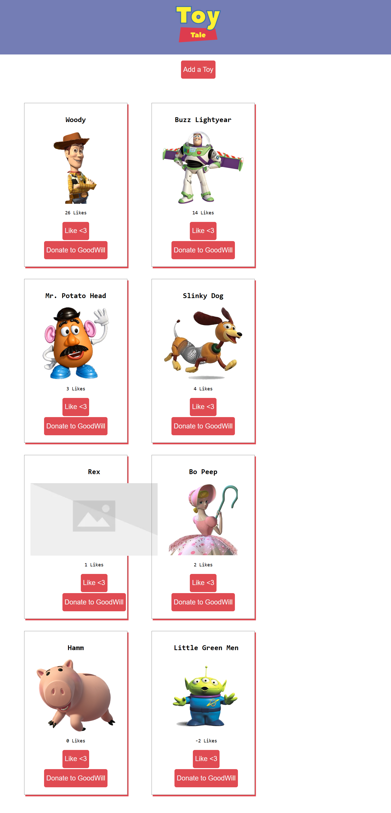

# Toy Tales

Toy Tales is a React application for browsing and managing Andy's toys. It uses
a local JSON Server API to list toys, create new toys, add likes, and donate
(delete) toys.

## Run locally

Install dependencies with `npm install`, then start each process in its own
terminal:

1. `npm run server` starts JSON Server at `http://localhost:3001`.
2. `npm run dev` starts the Vite development server. Open the URL printed by
   Vite (typically `http://localhost:5173`).
3. `npm run test` runs the test suite.

The app loads toys from `GET /toys`. Submitting the form creates a toy with
zero likes, the like button updates the toy's likes, and donating a toy removes
it from both the server data and the displayed collection.
